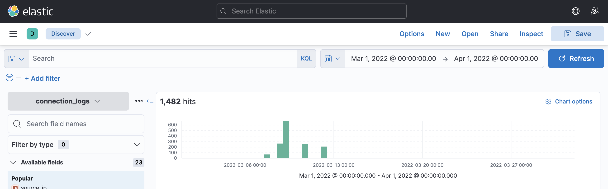
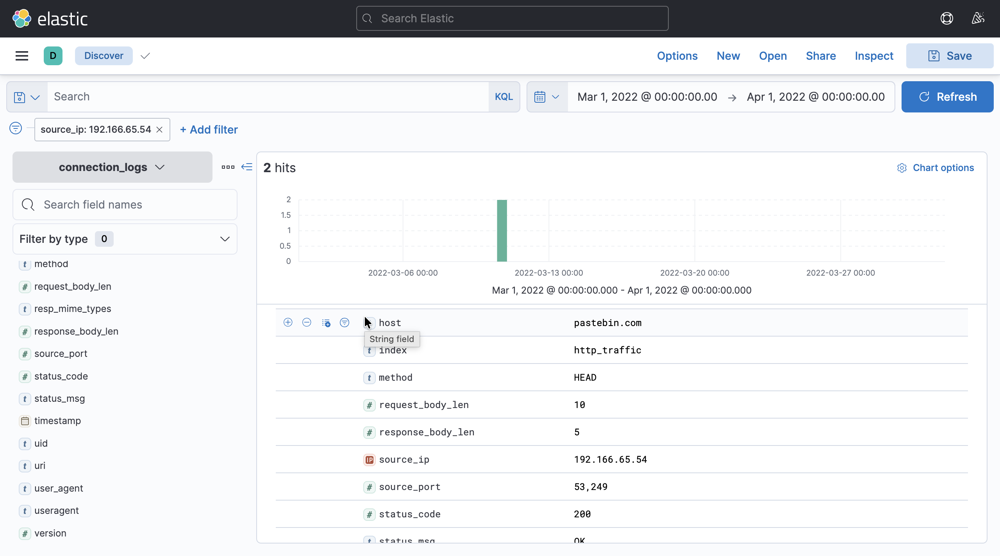
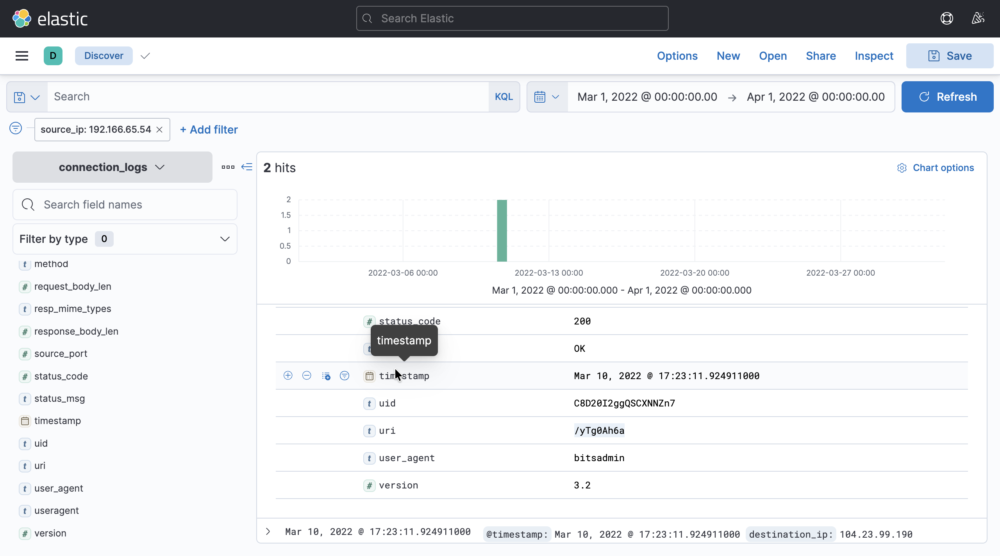
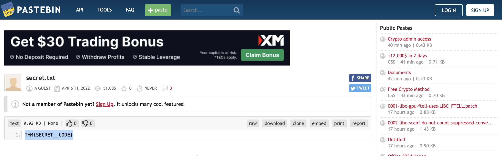
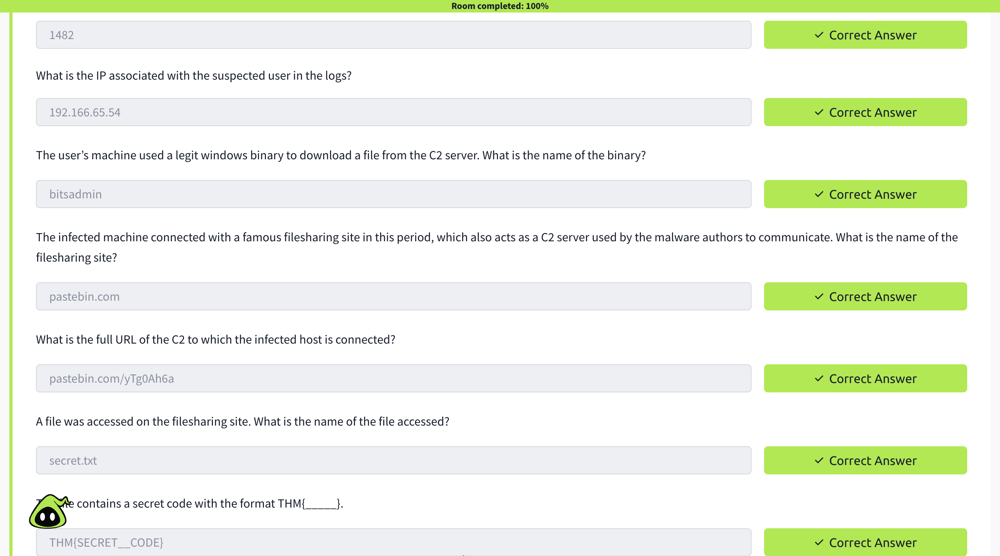

# TryHackMe: Itsy Bitsy – Write-up


-yellow)


A simple, step by step write-up of the **Itsy Bitsy** room from the TryHackMe **SOC Level 1** learning path.

**Analyst:** Md Obaydur Rahman (SOC Analyst)
**TryHackMe:** [obaydurrahman](https://tryhackme.com/p/obaydurrahman)
**GitHub:** [obaydur123](https://github.com/obaydur123)

---

## Table of Contents

1. [Scenario](#scenario)
2. [Tools Used](#tools-used)
3. [Investigation](#investigation)
4. [Answer Summary](#answer-summary)
5. [Attack Timeline](#attack-timeline)
6. [MITRE ATT&CK Mapping](#mitre-attck-mapping)
7. [Indicators of Compromise (IOCs)](#indicators-of-compromise-iocs)
8. [Lessons Learned](#lessons-learned)
9. [Recommendations](#recommendations)

---

## Scenario

An IDS alert said that someone in the company may have been talking to a C2 (Command and Control) server. As a SOC analyst, my job was to look at the HTTP connection logs in Elastic and find:

- who the suspected user is
- which tool they used
- where they connected
- what file they touched

The logs are in the `connection_logs` index. The time range is **March 1, 2022 to April 1, 2022**.

## Tools Used

- Elastic (Kibana Discover) with KQL and filters
- A web browser, to open the C2 URL

---

## Investigation

### Step 1: Count the logs

I set the time range to `Mar 1, 2022 @ 00:00:00.00` → `Apr 1, 2022 @ 00:00:00.00` and checked the hit count in Discover.

**Total logs: 1482**

Most of the traffic sits in a few days around March 10, which is a good hint for where to look.



### Step 2: Find the suspicious IP

I checked the `source_ip` field and looked for the odd one out. One IP had very few connections, so I added it as a filter:

```
source_ip: 192.166.65.54
```

The 1,482 hits dropped to just **2 hits**, all on the same day.

**Suspected IP: `192.166.65.54`**



### Step 3: Find the Windows binary

I opened the log and checked `user_agent`. It said **`bitsadmin`**.

`bitsadmin` is a real Windows tool made for background file transfers. Attackers like it because it is trusted and often not blocked. This kind of abuse is called a **LOLBin** (Living Off the Land Binary).

**Binary: `bitsadmin`**

### Step 4: Find the file sharing site

The `host` field showed **`pastebin.com`**. Malware authors use sites like Pastebin because the traffic looks normal and is rarely blocked.

**File sharing site / C2: `pastebin.com`**

### Step 5: Build the full C2 URL

| Field | Value |
|---|---|
| host | `pastebin.com` |
| uri | `/yTg0Ah6a` |

**Full URL: `pastebin.com/yTg0Ah6a`**

Other details from the same log:

| Field | Value |
|---|---|
| method | `HEAD` |
| status_code | `200` (OK) |
| source_port | `53249` |
| destination_ip | `104.23.99.190` |
| timestamp | Mar 10, 2022 @ 17:23:11 |
| user_agent | `bitsadmin` |
| version | `3.2` |



### Step 6: Open the file

I opened the URL in the browser. The paste was called **`secret.txt`**, and it had a single line inside.

**File name: `secret.txt`**



### Step 7: The secret code

**Secret code: `THM{SECRET__CODE}`**

---

## Answer Summary

| Question | Answer |
|---|---|
| Total logs in the date range | `1482` |
| IP of the suspected user | `192.166.65.54` |
| Windows binary used to download the file | `bitsadmin` |
| File sharing site used as C2 | `pastebin.com` |
| Full C2 URL | `pastebin.com/yTg0Ah6a` |
| File accessed | `secret.txt` |
| Secret code | `THM{SECRET__CODE}` |



---

## Attack Timeline

| Time | Event |
|---|---|
| Mar 10, 2022 @ 17:23:11 | Host `192.166.65.54` runs `bitsadmin` and connects to `pastebin.com/yTg0Ah6a` |
| Same time | Server replies with `200 OK` |
| Later | The file `secret.txt` is found on Pastebin with the secret code |

## MITRE ATT&CK Mapping

| Tactic | Technique | ID |
|---|---|---|
| Command and Control | Application Layer Protocol: Web Protocols | T1071.001 |
| Command and Control | Web Service | T1102 |
| Command and Control | Ingress Tool Transfer | T1105 |
| Defense Evasion | BITS Jobs | T1197 |

## Indicators of Compromise (IOCs)

| Type | Value |
|---|---|
| Source IP | `192.166.65.54` |
| Destination IP | `104.23.99.190` |
| Domain | `pastebin.com` |
| URL | `pastebin.com/yTg0Ah6a` |
| User agent | `bitsadmin` |
| File | `secret.txt` |

---

## Lessons Learned

- **Start wide, then narrow down.** 1,482 logs looked like a lot, but one filter on `source_ip` cut it to 2.
- **Check the user agent.** Command line tools like `bitsadmin` are a red flag in web traffic. Normal users use browsers.
- **Trusted sites can be used by attackers.** Pastebin, GitHub, and Dropbox are common C2 choices because they are rarely blocked.
- **Small fields matter.** Method, URI, and timestamp helped me build the full story.

## Recommendations

- Alert when `bitsadmin`, `certutil`, or `powershell` download files from the internet.
- Monitor or restrict access to paste and file sharing sites that are not needed for work.
- Isolate the host `192.166.65.54` and run a full investigation.
- Block the IOCs above on the proxy and firewall.

---

> This write-up is for learning only. The room is part of TryHackMe's SOC Level 1 path.
